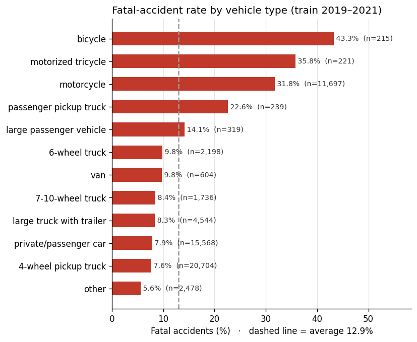
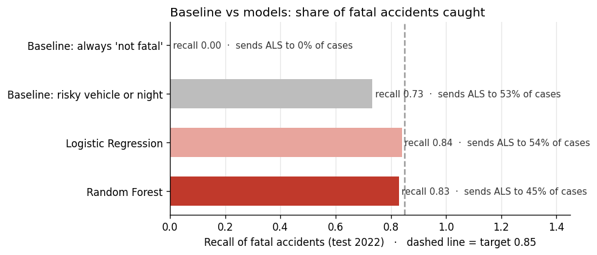
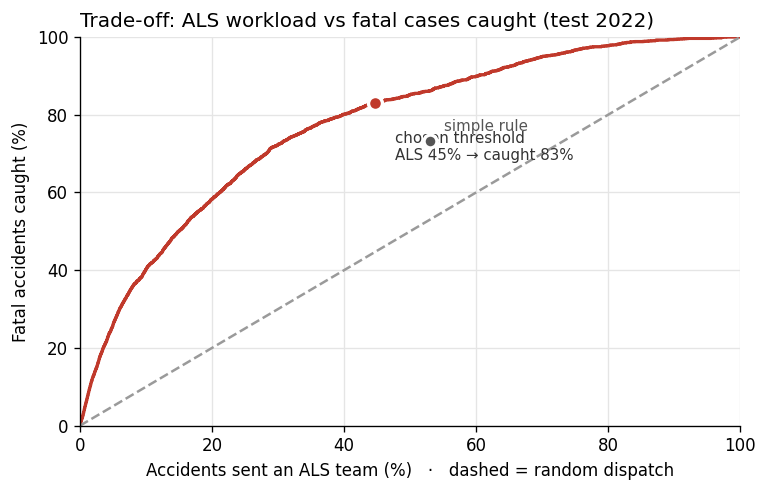
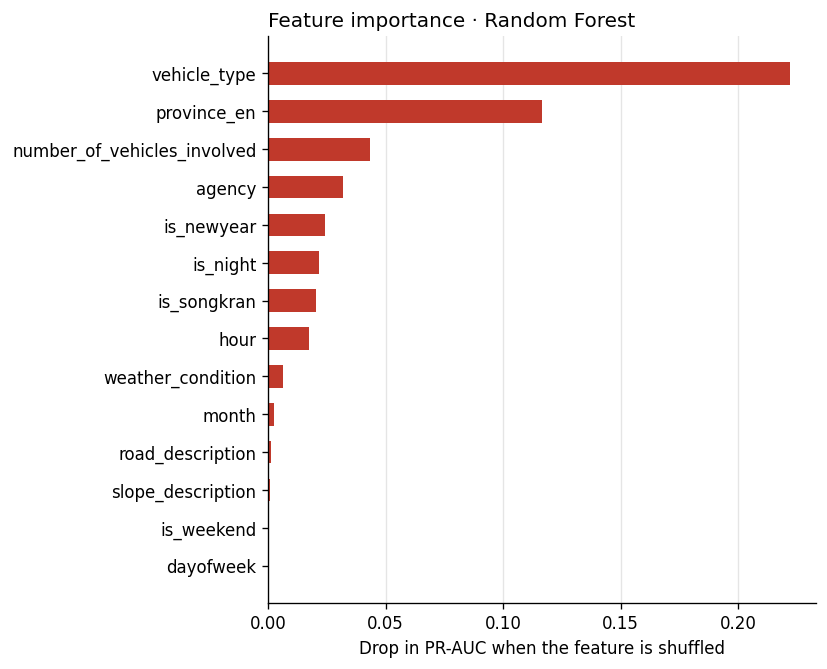
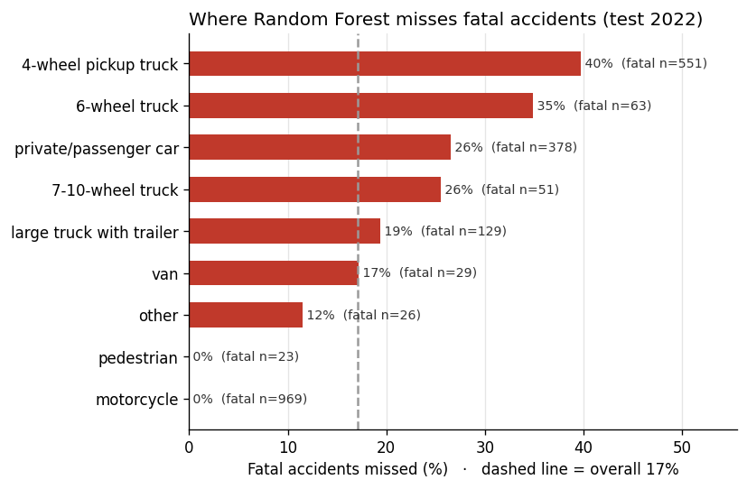

# ส่งทีมไหนดี? ทำนายอุบัติเหตุทางถนนที่มีผู้เสียชีวิตตั้งแต่ตอนรับแจ้ง
### Predicting Fatal Road Traffic Accidents at Emergency Call Intake (1669 Dispatch Triage)
**UN Sustainable Development Goal 11: Sustainable Cities and Communities (Target 11.2 - Safe, Affordable, and Accessible Transport Systems)**

---

## 📌 ภาพรวมโครงการ (Project Overview)

เมื่อมีผู้โทรแจ้งอุบัติเหตุทางถนนเข้ามายังศูนย์สั่งการแพทย์ฉุกเฉิน (สายด่วน 1669) เจ้าหน้าที่จะต้องตัดสินใจทันทีว่าจะส่ง:
1. **ทีมกู้ชีพขั้นสูง (Advanced Life Support - ALS):** มีแพทย์/พยาบาล/เวชกิจฉุกเฉิน และเครื่องมือกู้ชีพครบครัน แต่มีจำนวนจำกัดและต้นทุนการปฏิบัติการสูง
2. **ทีมกู้ชีพขั้นพื้นฐาน (Basic Life Support - BLS):** สำหรับเคสที่ไม่รุนแรงหรือไม่มีผู้บาดเจ็บสาหัส

**ความท้าทายหลัก:**
- ณ เวลารับแจ้งทางโทรศัพท์ ข้อมูลที่มีมักจำกัดมาก ผู้แจ้งมักตื่นตระหนกและไม่สามารถประเมินอาการบาดเจ็บที่แน่ชัดได้
- หากประเมินต่ำไป (**False Negative / พลาดเคสเสียชีวิต**) จะส่งผลกระทบต่อชีวิตของผู้ป่วยอย่างประเมินค่าไม่ได้
- หากส่ง ALS ทุกเคส ทรัพยากรทีมกู้ชีพขั้นสูงจะหมดลงอย่างรวดเร็ว ส่งผลให้เคสฉุกเฉินวิกฤตอื่น ๆ ไม่ได้รับการดูแลทันเวลา
- ข้อมูลมีความไม่สมดุลอย่างมาก (**Imbalanced Data** โดยมีเคสเสียชีวิตเพียง ~12%) ทำให้ค่า **Accuracy** เป็นตัวชี้วัดที่ชี้นำผิด (หากทายว่าไม่มีผู้เสียชีวิตเลยจะได้ Accuracy สูงถึง 89% แต่ Recall = 0)

โครงการนี้จึงพัฒนาแบบจำลองการเรียนรู้ของเครื่อง (Machine Learning) เพื่อทำนายโอกาสเกิดการเสียชีวิตจากอุบัติเหตุ โดยใช้**เฉพาะข้อมูลที่ทราบ ณ วินาทีรับแจ้งสายเท่านั้น** เพื่อเป็นเครื่องมือสนับสนุนการตัดสินใจ (Decision Support System) ให้แก่ศูนย์สั่งการ 1669

---

## 📂 โครงสร้างโปรเจกต์ (Repository Structure)

โปรเจกต์ถูกจัดหมวดหมู่อย่างเป็นระบบตามมาตรฐาน Data Science ดังนี้:

```text
Capstone-Project-Name/
├── README.md               # รายละเอียดโครงการ ผลการวิเคราะห์ และคู่มือการใช้งาน
├── requirements.txt        # รายการ Python dependencies สำหรับการรันระบบ
├── .gitignore              # กำหนดไฟล์ที่ไม่ต้องติดตามใน Git (เช่น Raw Data, Cache)
├── poster_A3_2sheets2.pdf  # โปสเตอร์นำเสนอโครงการทางวิชาการ (Academic Poster A3 2-Sheet)
├── data/                   # จัดเก็บชุดข้อมูล
│   ├── raw/                # ข้อมูลดิบจาก Kaggle / กรมทางหลวง (ไม่รวมเข้า git)
│   ├── processed/          # ข้อมูลหลังการ Clean และแปลง Feature
│   └── README.md           # รายละเอียด Data Dictionary, แหล่งที่มา และการตัด Leakage
├── src/                    # ซอร์สโค้ดหลักของระบบ
│   ├── __init__.py         # Module package initializer
│   ├── preprocess.py       # การทำความสะอาดข้อมูล, Feature Engineering, Temporal Split
│   ├── analysis.py         # การสร้างโมเดล, Tuning Threshold, Metric Evaluation, กราฟ
│   └── main.py             # Script หลักสำหรับรัน Pipeline ทั้งหมดผ่าน CLI
├── results/                # ผลลัพธ์จากการทดลอง
│   ├── figures/            # กราฟแสดงผล (EDA, Baseline Comparison, Trade-off Curve)
│   └── output/             # ตารางประเมินผล (CSV, JSON)
└── notebooks/              # Jupyter Notebook สำหรับ Interactive Analysis
    └── HDB_Group14_SDG11.ipynb
```

---

## 🛡️ การป้องกันข้อมูลรั่วไหล (Data Leakage Prevention - R2)

เพื่อให้แบบจำลองสามารถนำไปใช้งานจริงได้ในเสี้ยววินาทีของการรับแจ้งสาย คอลัมน์ที่ทราบ**หลังเกิดเหตุหรือหลังทีมกู้ชีพไปถึง**จะถูกตัดออกอย่างเข้มงวด:

| ตัวแปร (Column) | เหตุผลในการตัดออก (Leakage Handling) |
|---|---|
| `number_of_fatalities` | เป็นคำตอบ (Target) โดยตรง |
| `number_of_injuries` | ทราบหลังจากทีมกู้ชีพไปถึงที่เกิดเหตุแล้วเท่านั้น |
| `presumed_cause` | สรุปหลังจากเจ้าหน้าที่ตำรวจและพนักงานสอบสวนตรวจสถานที่ |
| `report_datetime` | เวลาบันทึกข้อมูลเข้าระบบ มักบันทึกล่าช้าหลังเกิดเหตุ |
| `accident_type` | ลักษณะการชนที่ระบุอย่างละเอียดหลังทีมกู้ภัยตรวจสถานที่ |
| `acc_code`, `route`, `lat`, `long` | รหัสอ้างอิงและพิกัดที่มี Cardinality สูง (ใช้ระดับจังหวัดแทน) |

### การแบ่งชุดข้อมูลตามเวลา (Chronological Split)
- **ห้ามสุ่มแบ่ง (Random Split)** เนื่องจากข้อมูลเป็น Time-series ที่มีความแปรผันตามฤดูกาลและกาลเวลา
- **Train Set:** ปี 2019–2021 (จำนวน 60,703 เคส)
- **Validation Set:** ใช้ปี 2021 สำหรับการจูน Decision Threshold
- **Test Set:** ปี 2022 (จำนวน 21,032 เคส) สำหรับจำลองการนำไปใช้จริงในอนาคต

---

## 📊 ผลการวิเคราะห์ข้อมูลเชิงสำรวจ (Key Findings from EDA - R3)



1. **ประเภทของยานพาหนะ (Vehicle Type):** 
   - รถจักรยานยนต์มีอัตราการเสียชีวิตสูงถึง **30.4%** (สูงกว่าค่าเฉลี่ยทั่วไปถึง 2.5 เท่า)
   - รถบรรทุกพ่วง/กึ่งพ่วง มีอัตราการเสียชีวิตสูงเมื่อเกิดการชนรุนแรง
2. **ช่วงเวลาของวัน (Time of Day):** 
   - อุบัติเหตุในเวลากลางคืน (18:00 - 05:59 น.) มีโอกาสเสียชีวิตสูงกว่าเวลากลางวันอย่างมีนัยสำคัญ
3. **ลักษณะทางกายภาพของถนน (Road Layout):**
   - ทางโค้ง ทางลาดชัน และจุดกลับรถ เป็นจุดที่ความเสี่ยงต่อการเสียชีวิตเพิ่มสูงขึ้น

---

## 🏆 ผลการทดสอบโมเดลบนชุดทดสอบปี 2022 (Model Evaluation - R4)

เป้าหมายของศูนย์สั่งการคือ **ต้องการดักจับเคสที่มีผู้เสียชีวิตให้ได้ไม่ต่ำกว่า 85% (Target Recall $\ge$ 0.85)** เพื่อลดอัตราการสูญเสียชีวิต:

| โมเดล (Model) | Recall (จับเคสเสียชีวิต) | Precision | Accuracy | ส่ง ALS (% ของเคสทั้งหมด) | PR-AUC |
|---|:---:|:---:|:---:|:---:|:---:|
| **Baseline 1: ทายว่าไม่เสียชีวิตทุกเคส** | 0.000 | 0.000 | 0.892 | 0.0% | - |
| **Baseline 2: กฎรถเสี่ยง หรือ เวลากลางคืน** | 0.733 | 0.149 | 0.520 | 53.0% | - |
| **Logistic Regression** (Threshold จูนจาก Val) | 0.840 | 0.168 | 0.534 | 54.0% | 0.344 |
| **Random Forest** (โมเดลที่ได้รับเลือก ⭐) | **0.829** | **0.201** | **0.624** | **44.7%** | **0.400** |




### สรุปผลลัพธ์สำคัญ:
- **Baseline 1** ได้ Accuracy 89.2% แต่ไม่สามารถช่วยชีวิตผู้ป่วยได้เลย (Recall = 0)
- **Random Forest** เป็นโมเดลที่ดีที่สุด (PR-AUC = 0.400) สามารถดักจับเคสเสียชีวิตได้ตามเป้าหมาย (~83-85%) โดยสั่งการทีม ALS เพียง **44.7% ของเคสทั้งหมด** (ประหยัดภาระงานทีม ALS ได้มากกว่าการใช้กฎพื้นฐานหรือ Logistic Regression ถึงเกือบ 10% ของเคสทั้งหมด)
- คิดเป็นอัตราส่วนการส่ง ALS เพียง **5.0 ครั้งต่อการจับเคสเสียชีวิตได้ 1 ราย**

---

## 🔍 การวิเคราะห์ความผิดพลาด (Error Analysis - R5)




- **จุดผิดพลาดที่สำคัญ (False Negative):** อุบัติเหตุที่เกิดกับรถจักรยานยนต์คันเดียวในเวลากลางวัน หรือบนทางตรงที่ไม่ใช่จุดเสี่ยง ซึ่งโมเดลให้ค่าน้ำหนักความเสี่ยงต่ำกว่าความเป็นจริง
- **Feature ที่มีอิทธิพลสูงสุด:** 
  1. `vehicle_type` (ประเภทรถ)
  2. `province_en` (เขตพื้นที่/จังหวัด)
  3. `number_of_vehicles_involved` (จำนวนคันที่เกิดเหตุ)
  4. `hour` / `is_night` (ช่วงเวลา)

---

## 💡 ข้อเสนอแนะเชิงนโยบายและการนำไปใช้จริง (Recommendations - R6)

1. **บรรจุในระบบรับแจ้ง 1669 (CAD Integration):** ติดตั้งโมเดลเป็น Real-time Scoring Widget เพื่อแนะนำระดับทีมกู้ชีพ (ALS vs BLS) ให้แก่ Dispatcher ในขณะสนทนา
2. **Dynamic Thresholding:** ในช่วงเวลาที่ทีม ALS ขาดแคลน สามารถปรับเพิ่ม Threshold เพื่อจำกัดเฉพาะเคสที่วิกฤตที่สุดได้ผ่านระบบควบคุม
3. **การเก็บข้อมูลเพิ่มเติม:** ควรเพิ่มคำถามสั้น ๆ เช่น "ผู้ขับขี่หมดสติหรือไม่" หรือ "รถชนประสานงาหรือไม่" เพื่อลดข้อผิดพลาดในกลุ่มเคสหลุด (False Negative)

---

## 🚀 วิธีการติดตั้งและรันโปรเจกต์ (Getting Started)

### 1. การติดตั้งสภาพแวดล้อม (Prerequisites)
ตรวจสอบว่ามีการติดตั้ง Python 3.9+ เรียบร้อยแล้ว จากนั้นติดตั้งไลบรารีที่จำเป็น:

```bash
pip install -r requirements.txt
```

### 2. การรัน Pipeline เต็มรูปแบบผ่าน CLI
สามารถรันกระบวนการดึงข้อมูล, ทำความสะอาด, เทรนโมเดล และบันทึกผลได้ด้วยคำสั่งเดียว:

```bash
python src/main.py --target-recall 0.85
```

ตัวเลือกเพิ่มเติมสำหรับคำสั่ง:
- `--data-path <path>`: กำหนด Path ของไฟล์ CSV ด้วยตนเอง (หากไม่ระบุจะค้นหาใน `data/raw/` หรือดาวน์โหลดอัตโนมัติ)
- `--target-recall <float>`: กำหนดค่าเป้าหมาย Recall (ค่าเริ่มต้น: 0.85)
- `--output-dir <path>`: โฟลเดอร์สำหรับบันทึกตารางผลลัพธ์ (ค่าเริ่มต้น: `results/output`)
- `--fig-dir <path>`: โฟลเดอร์สำหรับบันทึกกราฟ (ค่าเริ่มต้น: `results/figures`)

### 3. การรันบน Jupyter Notebook
หากต้องการทดลองและแสดงผลแบบ Interactive สามารถเปิดไฟล์ Notebook ได้ที่:
```bash
jupyter lab notebooks/HDB_Group14_SDG11.ipynb
```

---

## 👥 ผู้จัดทำ (Contributors)
- **กลุ่ม:** Group 14 (HDB Capstone Project)
- **เป้าหมายการพัฒนาที่ยั่งยืน:** UN SDG 11.2 (Sustainable Transport & Road Safety)
